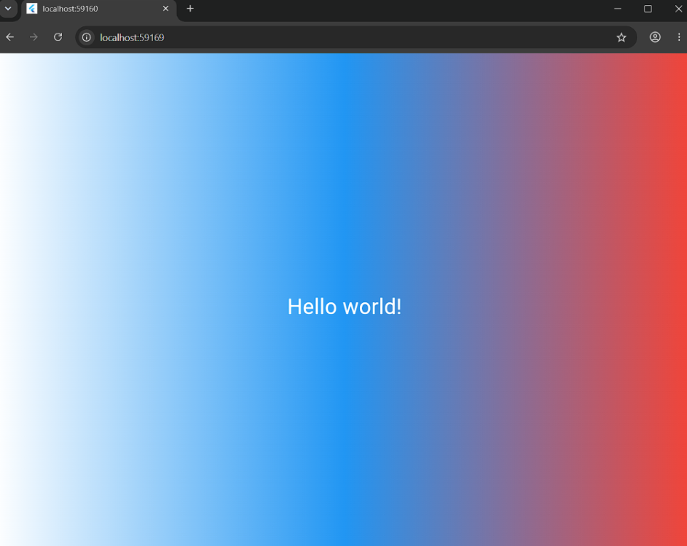

# Flutter Lab 3

Учебный проект по лабораторной работе №3. Первое знакомство с фреймворком Flutter: создание проекта, изучение структуры, работа с виджетами и деревом виджетов. Приложение запускается в браузере Chrome.

## Автор

Студент: Афанасьев Глеб Викторович
Группа: ИСП-241

## Стек и версии

- Flutter 3.x.x
- Dart 3.x.x
- Платформа: Web (Chrome)
- IDE: VS Code

## Скриншот приложения



## Запуск

1. Клонировать репозиторий:
```bash
   git clone <https://github.com/Fraay/Flutter_Lab3.git>`
```

2. Перейти в папку проекта:

```bash
    cd Flutter_Lab3
```

3. Выполнить:

```bash
   flutter pub get
```

4. Выполнить: flutter run -d chrome

## Что изучили:

* Установку и проверку окружения Flutter (`flutter doctor`, `flutter devices`).

* Структуру Flutter-проекта и назначение основных папок (`lib/`, `web/`, `pubspec.yaml` и др.).

* Базовые концепции: виджеты, дерево виджетов, `StatelessWidget` и `StatefulWidget`.

* Цепочку запуска приложения: `main()` → `runApp()` → `MaterialApp()` → `home:`.

* Работу с виджетами `Scaffold`, `Center`, `Container`, `Text`, `TextStyle`, `BoxDecoration`, `LinearGradient`.

* Инструменты разработчика: Hot Reload (`r`) и Hot Restart (`R`), Flutter DevTools и Flutter Inspector.
